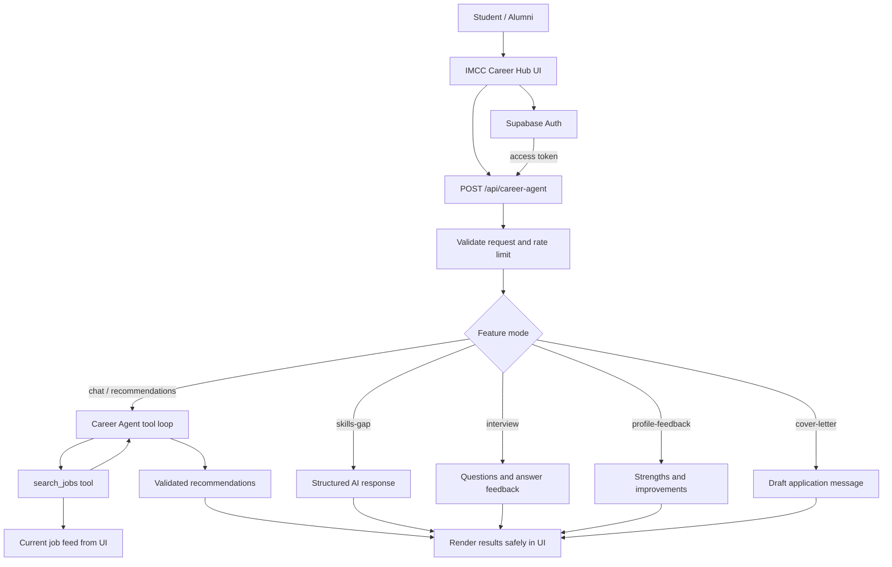

# IMCC Career Agent — structure and setup

## Recommended model

Use **`openai/gpt-oss-120b` on Groq** as the primary model. This project already uses Groq's OpenAI-compatible chat-completions endpoint and function calling, and the agent needs to reason about student profiles, search job data, and return structured recommendations. Groq currently lists GPT-OSS 120B as a production model with tool-use support. Use **`openai/gpt-oss-20b`** as the lower-cost/fallback option if you want to prioritize speed and budget over harder reasoning tasks.

Set these in **Vercel → Project → Settings → Environment Variables**:
- `GROQ_API_KEY` — required; create it in the Groq console. Never place it in HTML, `supabase-config.js`, or Git.
- `GROQ_MODEL` — optional; `openai/gpt-oss-120b`
- `GROQ_FALLBACK_MODEL` — optional; `openai/gpt-oss-20b`
- `ALLOWED_ORIGINS` — optional comma-separated list of additional exact origins if you use a custom domain.

After adding or changing environment variables, redeploy the Vercel project.

## Agent architecture

## Suggested modules and responsibilities

1. **Frontend (`index.html`, `styles.css`)**
   - Collect the user's career question.
   - Send a short prompt, selected job feed, and minimal profile data to the API.
   - Render AI output using DOM `textContent` rather than interpreting generated HTML.
   - Keep employer application links as the source of truth.

2. **API gateway (`api/career-agent.js`)**
   - Check HTTP method and request origin.
   - Require a valid institutional Supabase session for profile-based tools.
   - Apply request limits and timeouts.
   - Keep the Groq key on the server only.
   - Limit and sanitize prompts, profile fields, job descriptions, and AI output.

3. **Job search tool (`search_jobs`)**
   - Filter the supplied job feed by role keywords, category, and location.
   - Return only real listings from the feed.
   - The model may explain matches but must not invent vacancies, employers, salaries, or requirements.

4. **Career features**
   - **Career chat / job recommendations:** understand the question, search current openings, explain fit, suggest skills to build.
   - **Skills-gap checker:** compare stated skills with a selected job.
   - **Interview practice:** generate five role-specific questions, then score an answer and offer improvements.
   - **Profile feedback:** return strengths and improvement suggestions.
   - **Application message:** draft a 120–180 word message using only supplied profile facts.

5. **Data layer (Supabase)**
   - Use Supabase Auth for identity and the existing database for profiles/jobs.
   - For production, prefer querying published jobs server-side instead of trusting a job list supplied by the browser.
   - Keep RLS enabled. Never put the Supabase `service_role` key in browser code.

## What was fixed in this project copy

- Added API handling for the `skills-gap`, `interview`, `profile-feedback`, and `cover-letter` modes that the frontend already calls. Previously, the API only handled the default recommendation/chat request, so those other actions could fail.
- Applied shared rate limiting to all AI modes and required a verified Supabase user for profile-based tools.
- Fixed the build script: it no longer references a missing `flowise-widget.js`; it copies the actual static assets to `public/`.
- Connected `npm run build` to the build script and configured Vercel's static output directory as `public/`.

## Deploy checklist

1. Add `GROQ_API_KEY` in Vercel Environment Variables for **Production**, and Preview too if you test preview deployments.
2. Confirm `GROQ_MODEL=openai/gpt-oss-120b` and `GROQ_FALLBACK_MODEL=openai/gpt-oss-20b` (optional; defaults already exist in the API).
3. Commit and push the project changes.
4. Redeploy on Vercel.
5. Test each feature while signed in with an `@imcc.edu.ph` account:
   - Ask Career AI for jobs by course, skills, or location.
   - Open a job card and test “How ready am I?”
   - Run interview practice and submit an answer.
   - Request profile feedback.
   - Draft an application message.
6. Test an invalid request and confirm the UI displays a friendly error. Do not test by pasting the API key into browser code.

## Important limitations

- The current job-search tool searches only the jobs sent by the frontend. It is not a live web crawler and cannot guarantee listings are still open.
- The rate limiter is in-memory per serverless instance, so it is best-effort. Use a shared store (for example, Redis/Upstash) for strict production limits.
- AI output is advisory, not a hiring decision. Users should verify each posting and application link with the employer.
